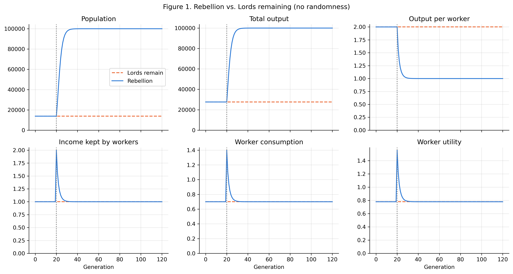
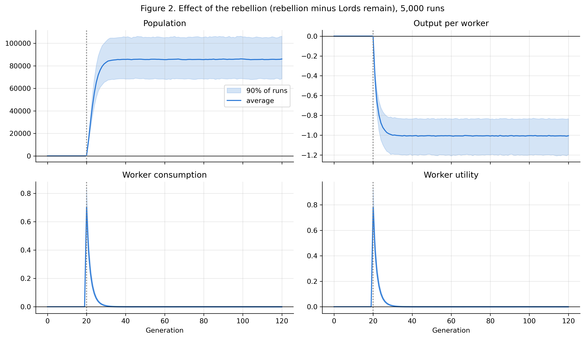

# The Paradox of Equality

### Redistribution in a Malthusian Economy

**What happens when workers overthrow an elite that takes half of everything they produce?** In this model, consumption doubles immediately. Over subsequent generations, population growth and diminishing returns to labor bring workers' living standards back to their original level.

An economic modeling and simulation project by **Adi Rosenstock**, developed for **ECON 324: Western Economic History at Northwestern University**. It combines an analytical equilibrium solution, deterministic transition dynamics, and **5,000 Monte Carlo simulations per scenario** to examine redistribution, inequality, and population growth in a preindustrial economy.

**[Read the paper](The_Paradox_of_Equality.pdf)** · **[Explore the notebook](malthusian_rebellion.ipynb)** · **[View the figures and tables](Appendix/)**



## Research question

The project compares two economies starting from the same equilibrium:

- **Lords remain:** a small elite continues to extract 50% of workers' output.
- **Rebellion:** extraction falls from 50% to zero in generation 20, and workers keep all their output.

Land and technology remain fixed. Households respond to higher retained income by consuming more and raising more children. More workers on the same land then reduce output per worker, eroding the initial gains. The simulation follows 121 generations, from generation 0 through 120.

## Main results

The baseline analytical equilibria are:

| Outcome | With Lords | Without Lords | Long-run change |
|---|---:|---:|---:|
| Worker population | 13,801 | 100,000 | 7.25× |
| Total output | 27,602 | 100,000 | 3.62× |
| Output per worker | 2.00 | 1.00 | −50% |
| Income retained per worker | 1.00 | 1.00 | Unchanged |
| Consumption per worker | 0.70 | 0.70 | Unchanged |
| Utility per worker | 0.779 | 0.779 | Unchanged |

At the moment of rebellion, population and output have not yet adjusted, so retained income, consumption, expected surviving children, and utility all double. Population begins adjusting in the next generation.

The Monte Carlo simulation reproduces the temporary consumption gain:

| Generations after rebellion | Average consumption gain |
|---|---:|
| 0 | 100.00% |
| 1 | 56.91% |
| 5 | 8.37% |
| 10 | 0.94% |
| 25 | 0.01% |
| 50 | Approximately zero |

The average gain falls below 1% after **10 generations** in both the deterministic model and the baseline stochastic simulation. These are model generations, not years.

## The model

Workers produce using a Cobb-Douglas technology with fixed land:

$$Y_t = A L_t^{\alpha} H^{1-\alpha}$$

After the Lords extract a share $\tau_t$, each worker retains:

$$w_t = (1-\tau_t)\frac{Y_t}{L_t}$$

Households maximize $u_t = c_t^{1-\gamma}n_t^{\gamma}$ subject to $c_t + \rho n_t = w_t$, where $n_t$ is expected surviving children and $\rho$ is the cost of raising a child. Their choices are:

$$c_t = (1-\gamma)w_t, \qquad n_t = \frac{\gamma w_t}{\rho}, \qquad L_{t+1} = n_t L_t$$

A stationary population requires one surviving child per worker, giving:

$$w^* = \frac{\rho}{\gamma}, \qquad L^* = H\left[\frac{A(1-\tau)\gamma}{\rho}\right]^{\frac{1}{1-\alpha}}$$

Extraction changes equilibrium population but leaves equilibrium retained income and consumption unchanged. For the baseline tax reduction, the population ratio is $2^{1/(1-\alpha)}$ and the total-output ratio is $2^{\alpha/(1-\alpha)}$.

| Parameter | Meaning | Baseline |
|---|---|---:|
| $A$ | Technology | 1 |
| $H$ | Fixed land | 100,000 |
| $\alpha$ | Labor exponent in production | 0.65 |
| $\gamma$ | Household preference weight on children | 0.30 |
| $\rho$ | Cost per surviving child | 0.30 |
| $\tau$ | Elite extraction | 0.50, then 0 after rebellion |

## Uncertainty and sensitivity

The stochastic model adds two sources of uncertainty:

- **Harvest shocks:** productivity is multiplied by a mean-one lognormal shock with log standard deviation 0.10 in the baseline.
- **Demographic noise:** next generation's population is drawn from a Poisson distribution with mean $n_t L_t$.

The two scenarios use the same harvest shocks to make their outcomes comparable. Harvest and birth draws use separate random-number generators with fixed seeds. Utility is evaluated using expected surviving children. The Monte Carlo figure shows the mean difference and the 5th–95th percentile range across runs; the notebook also reports 95% confidence intervals for the estimated mean consumption gain.



Sensitivity experiments use 1,000 runs per scenario and vary harvest volatility, the labor exponent, preferences for children, and initial extraction. Across the tested settings, the average consumption gain falls below 1% within **5–15 generations**. The labor exponent controls how quickly the gain fades; initial extraction strongly affects the size of the eventual population increase.

The notebook also compares equilibria across extraction rates and outlines how the predictions could be tested with historical population, wage, agricultural-output, and feudal-rent data.

## Reproduce the analysis

Use **Python 3.11** (the version used to validate the notebook) and create a virtual environment:

```bash
git clone https://github.com/AdiRosenstock/malthusian-rebellion.git
cd malthusian-rebellion
python3 -m venv .venv
source .venv/bin/activate
python -m pip install -r requirements.txt
jupyter notebook malthusian_rebellion.ipynb
```

On Windows, activate the environment with `.venv\Scripts\activate` instead.

Run all cells from the top. The notebook contains the equations, simulations, equilibrium checks, plots, Monte Carlo summaries, sensitivity experiments, and figure/table export code. Running it regenerates `Figure1.png`–`Figure3.png` and `Table1.png`–`Table2.png` inside `Appendix/`. Saved outputs are included so the results can also be read directly on GitHub.

To execute the notebook without opening the interactive editor:

```bash
jupyter nbconvert --to notebook --execute malthusian_rebellion.ipynb \
  --output malthusian_rebellion.executed.ipynb \
  --output-dir /tmp/malthusian-rebellion
```

The main analysis uses **NumPy, pandas, Matplotlib, and Jupyter**. pandas 2.1 or newer is required for the table exports.

## Repository contents

```text
.
├── README.md                         # Project overview and reproduction guide
├── The_Paradox_of_Equality.pdf        # Paper, including appendix and references
├── malthusian_rebellion.ipynb         # Complete analysis with saved outputs
├── requirements.txt                  # Python dependencies
└── Appendix/
    ├── Figure1.png                   # Deterministic transition
    ├── Figure2.png                   # Monte Carlo differences
    ├── Figure3.png                   # Equilibria across extraction rates
    ├── Table1.png                    # Equilibrium comparison
    └── Table2.png                    # Consumption gains over time
```

## Interpretation and limits

This is an illustrative simulation, not an empirical estimate of a historical rebellion or a prediction for a modern economy. Parameters are not calibrated to a particular society. The model holds land, technology, and household preferences fixed and omits migration, capital accumulation, changing institutions, and the destruction associated with conflict. Its result concerns workers' per-person living standards; it does not measure total social welfare, including the displaced elite or additional people.

Within those assumptions, the central result is that a permanent reduction in extraction can produce a larger population and greater total output without a permanent increase in worker consumption.

## References

- Ashraf, Quamrul, and Oded Galor. 2011. “Dynamics and Stagnation in the Malthusian Epoch.” *American Economic Review* 101(5): 2003–2041. DOI: `10.1257/aer.101.5.2003`.
- Malthus, Thomas Robert. 1798. *An Essay on the Principle of Population.* London: J. Johnson.
- Northwestern University. 2026. “The Malthusian Epoch.” ECON 324: Western Economic History, course lecture slides.
